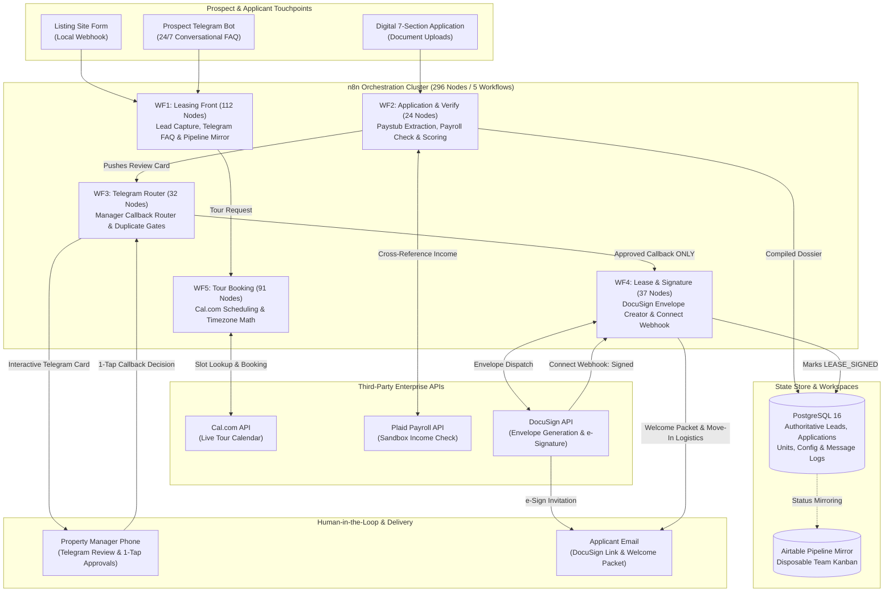

# Autonomous Leasing, Tour Scheduling & Tenant Screening Engine

[](https://n8n.io)
[](https://www.postgresql.org)
[](https://www.docker.com)
[](https://www.docusign.com)
[](https://cal.com)
[](https://plaid.com)
[](#the-single-path-from-review-to-lease)

> **An event-driven leasing automation pipeline that handles the full renter lifecycle: instant 24/7 lead inquiries, property-local tour bookings via Cal.com, fraud-proof income verification comparing paystubs to Plaid payroll data, mobile human-in-the-loop application triage, and automated DocuSign lease execution.**

---

## The Operational Problem

Residential leasing teams face an unsustainable operational trade-off between speed and risk:
* **The Speed Penalty**: Rental vacancies take an average of **34 to 41 days to lease**, with every vacant day burning **$55 to $60 in unrecoverable rent loss** (*Apartment List & Zillow Benchmarks*). Renters typically browse multiple listings outside business hours (8:00 PM to midnight). Operators who take hours or days to respond lose qualified prospects to faster competitors.
* **The Application Fraud Epidemic**: A landmark survey by the National Multifamily Housing Council (NMHC) revealed:
  * **93%** of rental housing providers experienced fraud in the past 12 months.
  * **85%** received falsified pay stubs or altered bank statements.
  * **75%** named fake pay stubs as their single greatest fraud vulnerability.
  * **23.8%** of evictions trace directly back to fraudulent applications.
* **The Cost of Bad Verification**: Evicting a fraudulent tenant takes **3 to 9 months**, costing between $5,000 and $10,000+ in legal fees, physical turnover, and lost rent.

### The Solution
This system creates an automated, compliance-safe **inquiry-to-lease pipeline**:
1. **Instant 24/7 Inquiry Handling**: Answers prospect questions within seconds via a dedicated Telegram prospect channel and web listing portal, restricting answers strictly to verified unit attributes.
2. **Autonomous Tour Scheduling**: Books confirmed tour slots directly onto Cal.com, handling property-local timezone conversions and routing after-hours tour exceptions to managers.
3. **Automated 7-Section Application & Fraud Detection**: Collects application data, extracts paystub income details via OCR/LLM schemas, and cross-references them against payroll income data.
4. **Fair Housing Compliance**: AI models never make rental decisions. The engine evaluates fixed objective rules (e.g. 3x rent ratio, credit tiers) and compiles an audit-proof scorecard.
5. **1-Tap Mobile Lease Dispatch**: The property manager reviews the complete dossier in Telegram and taps `[Approve]`, triggering automated DocuSign lease generation and envelope tracking.

---

## System Architecture



---

## Core Engineering Highlights & Guarantees

### 1. The Single Path from Review to Lease
Lease creation commits a legal contract and reserves inventory.
* WF4 (`lease-and-signature`, 37 nodes) creates DocuSign envelopes and manages execution callbacks.
* **Guarded Invariant**: WF4 has **no public trigger**. Its entry point is an `Execute Sub-workflow Trigger` called exclusively by WF3 (`telegram-router`).
* The call is strictly gated behind an authenticated manager Telegram callback approving the application.
* **Database State Guard**: Before invoking DocuSign, the workflow checks PostgreSQL to confirm the application is in `PENDING_REVIEW` state and not previously signed or declined. Concurrent callbacks or double-clicks are stopped by database row-level locking.

### 2. Multi-Tier Income Fraud Detection
Application fraud cannot be caught by visual inspection alone.
* **OCR & Structured Paystub Extraction**: Extracts employer name, pay period dates, gross earnings, and year-to-date income under strict JSON schemas.
* **Direct Payroll Cross-Reference**: Connects to payroll sources via Plaid Sandbox, extracting authoritative historical earnings and employer verification.
* **Objective Variance Thresholds**: Compares stated income against verified deposits. A variance exceeding configured criteria (e.g. >10% discrepancy) flags the record as `INCOME_MISMATCH` and requires manager inspection before lease generation.

### 3. Fair Housing & Regulatory Compliance Boundaries
Under US Fair Housing Act regulations, automated screening tools must not introduce discriminatory bias or black-box rejections.
* **No Autonomous Denials**: The system is programmatically forbidden from rejecting applicants automatically.
* **Objective Criteria Config**: PostgreSQL table `criteria_config` stores explicit property-wide thresholds (e.g., minimum income-to-rent ratio = 3.0x, credit score tier = 650+).
* The engine performs mathematical calculations against these rules and generates an objective scorecard. The final decision to approve, condition, or decline is made exclusively by an authorized human manager.

### 4. Property-Local Timezone Scheduling Engine
Tour scheduling across national portfolios frequently introduces timezone errors.
* **WF5 (Tour Booking)** dynamically resolves the target property's timezone from PostgreSQL (`America/Phoenix`, `America/New_York`, etc.).
* Translates prospect conversational requests into localized ISO 8601 timestamps before checking Cal.com availability.
* Enforces minimum notice windows (e.g., 2-hour buffer) and business operating hours, automatically flagging off-hours requests for manual review.

---

## Workflow Architecture (296 Nodes / 5 Workflows)

| Workflow File | File Name | Nodes | Primary Responsibilities |
| :--- | :--- | :---: | :--- |
| **WF1: Leasing Front** | `n8n-workflows/wf1-leasing-front.json` | 102 | Listing inquiries, prospect Telegram bot conversation, unit FAQ answers, Cal.com webhook intake, pipeline sync. |
| **WF2: Application & Verify** | `n8n-workflows/wf2-application-and-verify.json` | 24 | Ingests 7-section application, extracts paystub income, checks Plaid payroll, scores criteria, drafts review card. |
| **WF3: Telegram Router** | `n8n-workflows/wf3-telegram-router.json` | 16 | Manager action surface, parses inline callbacks, prevents duplicate decisions, routes to lease execution. |
| **WF4: Lease & Signature** | `n8n-workflows/wf4-lease-and-signature.json` | 25 | **The Single Lease Gate**. Populates lease template, creates DocuSign envelope, processes Connect webhook, sends welcome mail. |
| **WF5: Tour Booking** | `n8n-workflows/wf5-tour-booking.json` | 29 | Queries Cal.com slots, converts property-local time, enforces tour policies, books appointments, sends confirmations. |

---

## Tech Stack

* **Workflow Orchestration**: [n8n v2.x](https://n8n.io) (Self-Hosted on Docker Compose)
* **Authoritative Database**: [PostgreSQL 16](https://www.postgresql.org) (6 tables with foreign keys and unique ticket constraints)
* **Digital Signatures**: [DocuSign Developer API](https://developers.docusign.com) (Envelopes & DocuSign Connect Webhooks)
* **Tour Scheduling**: [Cal.com API](https://cal.com) (Cloud scheduling with custom availability)
* **Income Verification**: [Plaid API](https://plaid.com) (Payroll Income Sandbox integration)
* **Action Surfaces**: Dual Telegram Bots (Prospect Bot & Manager Bot)
* **Team Pipeline Mirror**: [Airtable API](https://airtable.com) (Disposable read-only pipeline display)
* **Web Listing Frontend**: Zero-dependency static HTML server on Node.js

---

## Automated Verification & Test Suite

The repository includes a standalone test suite with **69 automated passing checks**:

```bash
cd leasing-tenant-screening
node scripts/test-leasing-lib.js       # 32 checks passed (time zones, FAQ matching, unit rules)
node scripts/test-screening-lib.js     # 19 checks passed (income ratio math, criteria gates)
node scripts/test-application-form.js  #  8 checks passed (7-section form parsing & validation)
node scripts/test-pipeline-mirror.js   # 10 checks passed (Airtable payload normalization)
```

---

## Local Setup & Quickstart

### Prerequisites
* Docker & Docker Compose
* Node.js v18+
* PowerShell (Windows) or Bash (macOS/Linux)

### Quickstart Instructions

1. **Clone the Repository:**
   ```bash
   git clone https://github.com/SambhavJain26/leasing-tenant-screening.git
   cd leasing-tenant-screening
   ```

2. **Configure Environment:**
   ```bash
   cp .env.example .env
   ```
   Add your PostgreSQL passwords, n8n encryption key, OpenAI API key, and DocuSign credentials to `.env`.

3. **Start the Stack:**
   ```bash
   docker compose up -d postgres n8n
   ```

4. **Initialize Database Schema & Fixtures:**
   ```powershell
   # In PowerShell
   .\scripts\init-database.ps1
   ```

5. **Start the Local Listing Server:**
   ```bash
   node scripts/serve-listing.js
   ```
   *Access the listing site at `http://localhost:8080` to test inquiries, tour booking, and digital applications.*

---

## Technical Trade-offs & Engineering Decisions

| Decision | Selected Approach | Alternative Rejected | Rationale |
| :--- | :--- | :--- | :--- |
| **State Authority** | PostgreSQL 16 | Airtable / Baserow | Screening data and legal lease references require relational integrity, foreign keys, and audit logging that low-code spreadsheets cannot guarantee. |
| **Tour Calendar** | Cal.com API | Calendly / Custom DB Calendar | Cal.com provides open API slot queries and webhook payloads while avoiding the maintenance burden of building custom calendar engines. |
| **E-Signature** | DocuSign Connect | HelloSign / Custom PDF Generator | DocuSign is the enterprise standard recognized by institutional property owners, with tamper-proof audit trails and webhooks. |
| **Income Verification**| Plaid Sandbox + OCR | Manual Document Review | Automated cross-referencing exposes forged paystubs in seconds, protecting owners against five-figure eviction losses. |
| **Decision Authority** | Human Manager in Telegram | Full AI Auto-Leasing | Autonomous rental decisions violate Fair Housing compliance frameworks and expose operators to statutory discrimination liabilities. |

---

## License & Security
Private Client Build: Proprietary Intellectual Property. All applicant identities, financial profiles, and property addresses in this repository are synthetic test fixtures.
